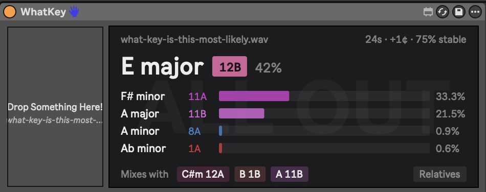
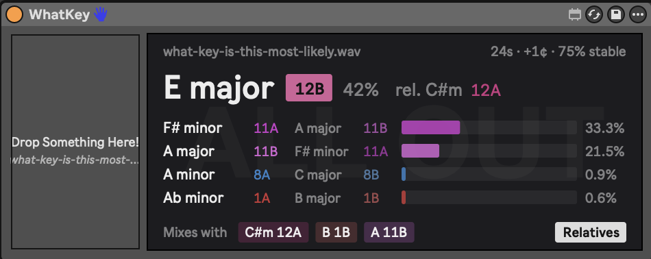
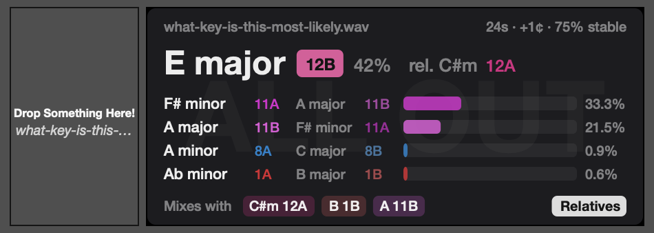

# what-key-is-this

Estimates the most likely musical keys of audio files, with Camelot codes and
harmonically compatible keys. Use it as a command-line tool, as a drag-and-drop
Max for Live device inside Ableton Live, or as a VST3/AU plugin for FL Studio (or any other DAW).



## Requirements

- Python 3.9+
- [numpy](https://numpy.org/) (`pip install -r requirements.txt`)
- [ffmpeg](https://ffmpeg.org/) on your `PATH` (used to decode wav, mp3, flac, m4a, ogg, aiff, ...)

## Usage

Drop audio files into `audio-to-analyze/` and run:

```
python3 whatkey.py                  # analyzes everything in audio-to-analyze/
python3 whatkey.py song.mp3 -n 8    # specific files/folders, show top 8 keys
python3 whatkey.py -t 0.1           # softer (less peaky) percentages
python3 whatkey.py song.wav --json  # machine-readable output
```

Example output:

```
my-track.wav  (24s, tuning +1 cents)
----------------------------------------------------
 1. E major     12B   42.4%  #################
 2. F# minor    11A   33.3%  #############
 3. A major     11B   21.5%  #########
 4. A minor      8A    0.9%
 5. Ab minor     1A    0.6%
Segment agreement with #1: 75% of 4 x 6s chunks
Harmonically compatible with #1:
    relative          C# minor    12A    0.0%
    dominant (V)      B major      1B    0.6%
    subdominant (IV)  A major     11B   21.5%
```

- **Camelot code**: DJ wheel notation; adjacent numbers / same number with A↔B mix well.
- **Percentage**: relative confidence (softmax of profile correlations), not a calibrated probability.
- **Segment agreement**: how often shorter chunks of the track pick the same top key; low values suggest modulation or ambiguity.
- Keys that share most of their notes (e.g. E major / A major / F# minor) often land close together; that's expected.

## Ableton Live device (Max for Live)

Requires Live Suite (or Max for Live). From the repo folder:

```
python3 ableton/build_device.py
```

This installs **WhatKey** into `User Library/Presets/Audio Effects/Max Audio Effect/`.
Drag it onto any audio track (audio passes through untouched), then drop an audio file,
from Finder or Live's browser, onto the left panel. The device shows:

- the file name, length, tuning offset and segment agreement ("stable")
- the top key with its Camelot badge and confidence
- the next four candidates as bars
- **Mixes with**: the relative, dominant (V) and subdominant (IV) keys of the top pick
- a **Relatives** toggle (off by default) that adds the relative major/minor next to every ranked key



The last dropped file is remembered with the Live Set and re-analyzed when the set opens.

**Files:** `ableton/build_device.py` generates the `.amxd`; `ableton/whatkey-node.js` (Node for Max)
runs `whatkey.py --json`; `ableton/whatkey-ui.js` (`v8ui`) draws the panel and reloads in Live
automatically when edited.

The device points at this folder by absolute path and runs `whatkey.py` with the Python that ran
the build script, so re-run the build if you move the repo or switch Python installs.

## FL Studio / VST3 + AU plugin (macOS)

The same interface as a regular plugin, built with [JUCE](https://juce.com). Needs Xcode
(or the Command Line Tools) and CMake (`brew install cmake`). From the repo folder:

```
./fl-studio/build.sh
```

The first build downloads JUCE and takes a few minutes. It installs:

- `~/Library/Audio/Plug-Ins/VST3/WhatKey.vst3`
- `~/Library/Audio/Plug-Ins/Components/WhatKey.component` (AU, for Logic, GarageBand, etc.)

In FL Studio: **Options → Manage plugins → Find more plugins**, then add **WhatKey** to any
mixer insert (audio passes through untouched). Drag an audio file from Finder or FL's browser
onto the plugin, or click the drop zone to pick a file. Like the Live device, it remembers the
last file with your project and has the same **Relatives** toggle.



Like the Live device, the plugin runs `whatkey.py` with the Python and paths found at build time,
so re-run `build.sh` if you move the repo or switch Python installs. macOS only for now.
Validated with [pluginval](https://github.com/Tracktion/pluginval) (strictness 10) and `auval`.

## How it works

1. Decode to mono 22.05 kHz with ffmpeg.
2. STFT, then estimate global tuning offset from interpolated spectral peaks (handles tracks not at A=440).
3. Fold log-compressed spectral energy (55 Hz–4 kHz) into a 12-bin chromagram, skipping near-silent frames.
4. Correlate the average chroma with Krumhansl-Kessler and Temperley major/minor profiles for all 24 keys and average the two.
5. Softmax the scores into percentages.

## License

[MIT](LICENSE) © neutrinoevent
